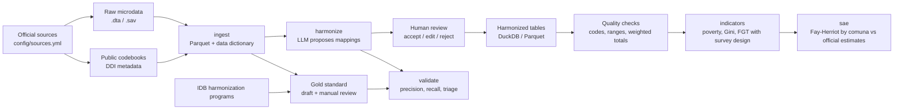
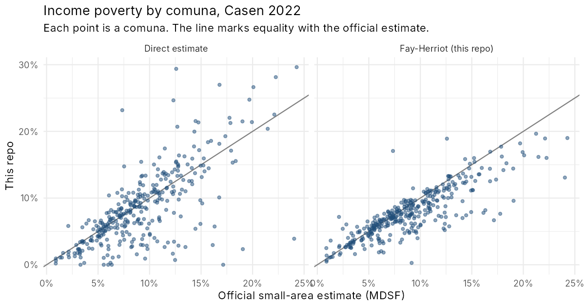
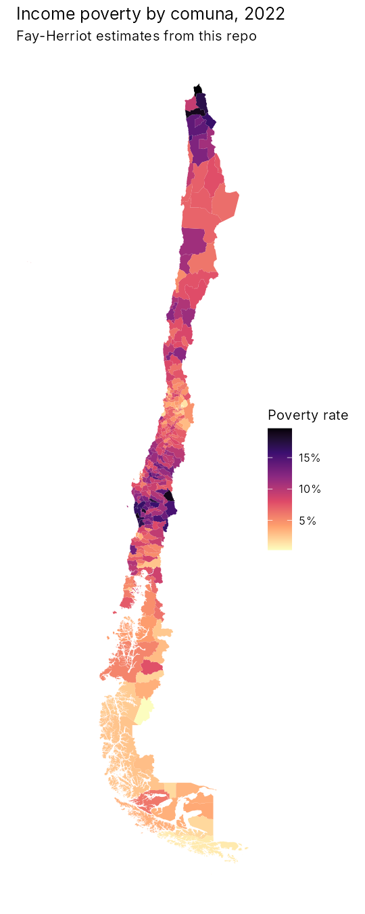

# LLM-assisted harmonization of Latin American household surveys

A small, reproducible pipeline that uses a language model to propose how raw household
survey variables map to a common schema, checks every proposal against a human-built
reference, and carries the harmonized data through to poverty and inequality indicators
and a small-area poverty map.

Scope for v1: eight surveys from three countries.

| Country | Survey | Rounds |
|---|---|---|
| Chile | Encuesta de Caracterización Socioeconómica Nacional (Casen) | 2015, 2017, 2020, 2022 |
| Bolivia | Encuesta de Hogares (EH) | 2017, 2021 |
| Costa Rica | Encuesta Nacional de Hogares (ENAHO) | 2017, 2022 |

> One survey, Casen 2022, runs end to end: mapping, review, generated code, harmonized
> table, occupation and industry coding, indicators and comuna estimates. The other seven stop after the mapping
> evaluation. The status table says what runs and what is missing, and
> `docs/methodology.md` gives the method and its limits.

## Why this design

Harmonizing surveys by hand is slow, and a language model can draft most of the variable
mappings in minutes. The open question is how far those drafts can be trusted. This repo
treats that as a measurement problem:

- The target schema uses the variable names of the IDB's harmonized household surveys.
- The IDB publishes the Stata programs it uses to build those variables for each survey.
  `harmonize/extract_gold_from_idb.py` reads those programs and records which raw
  variables feed each harmonized variable. After a manual review, that table is the
  gold standard.
- The model sees only the survey's data dictionary (names, labels, value labels and,
  where the statistics office publishes it, the question text). It never sees the
  microdata or the IDB programs.
- Every proposal lands in a review file where a person accepts, edits or rejects it.

## Pipeline



## What the reference shows so far

These numbers come from the draft gold standards for the 58 target variables
(`docs/reference_across_rounds.md`). The drafts are parser output and still need a
manual review, so read them as a first description, not as final results.

**The gold extraction holds up against real data dictionaries.** Of 697 raw-variable
names the parser pulled out of the eight IDB programs, 687 (98.6%) exist in the
corresponding survey's data dictionary.

**The same concept moves between rounds, and how much depends on the survey.**

| Country | Targets mapped in every round | Built from different raw variables across rounds |
|---|---|---|
| Bolivia (2017, 2021) | 44 | 33 |
| Chile (2015, 2017, 2020, 2022) | 32 | 14 |
| Costa Rica (2017, 2022) | 45 | 2 |

Bolivia renumbers its questionnaire sections between 2017 and 2021 (sex is `s02a_02`,
then `s01a_02`), so a mapping carried forward from the earlier round fails for three
targets out of four. Costa Rica keeps stable variable names. A model that reads each
dictionary from scratch should be indifferent to this, and the evaluation will show
whether it is.

**Coverage differs across countries.** 23 of the 58 targets have a raw mapping in all
eight surveys.

## Status

| Step | Script | State |
|---|---|---|
| Download from official sources, with file hashes | `scripts/download_data.py` | Runs. Open files for all eight surveys are listed in `config/sources.yml` |
| Unpack archives | `ingest/unpack.py` | Zip runs. The `.rar` path (Casen 2015, 2017) needs `unar` or `unrar` and is untested in CI |
| Raw file to Parquet and data dictionary | `ingest/to_parquet.py` | Runs on the four Casen rounds (chunked, 0.5 to 2.2 GB Stata files) and on Bolivia's person, dwelling and asset files |
| Data dictionary from a public DDI codebook | `ingest/ddi_to_dictionary.py` | Runs on Bolivia and Costa Rica |
| Draft gold standard from IDB programs | `harmonize/extract_gold_from_idb.py` | Runs on all eight surveys, drafts need manual review |
| Reference compared across rounds and countries | `harmonize/compare_rounds.py` | Runs |
| LLM mapping proposals | `harmonize/propose_mappings.py` | Runs against the API with prompt caching. All eight surveys run once |
| Evaluation against gold | `validate/evaluate_mappings.py`, `validate/summarize.py` | Runs on all eight surveys, against draft gold standards |
| Gold review | `validate/build_review.py`, `validate/apply_review.py` | Casen 2022 reviewed in full, as the case study. Review sheets for the other seven surveys are built and unreviewed |
| Value and population checks | `validate/checks.py` | Runs, tested |
| Recoding code written by the model from reviewed mappings | `harmonize/generate_code.py` | Runs. Casen 2022: 50 SQL expressions in `harmonize/code/CHL_2022.yml` |
| Test each expression and build the harmonized table | `harmonize/build_harmonized.py` | Runs. Casen 2022: 47 of 58 targets built, report in `docs/harmonized_CHL_2022.md` |
| Poverty and inequality indicators | `indicators/poverty_inequality.R` | Runs on Casen 2022 |
| Small-area estimation | `sae/prepare_aux.py`, `sae/fay_herriot.R` | Runs on Casen 2022, compared with the ministry's comuna estimates |
| Occupation and industry coding from open text | `coding/code_occupation_industry.py`, `coding/evaluate_coding.py` | Runs on a sample of 1,500 Casen 2022 workers, scored against the ministry's ISCO-08 and industry codes |
| Harmonized tables for the other seven surveys | | Not built. They need a reviewed gold standard first |

Checks on the ingested files are in `docs/ingest_checks.md`: person counts, household
counts, weighted population totals and the weighted share of persons each statistics
office classifies as poor. Costa Rica's microdata is not ingested yet. The 2022 file reproduces the published income poverty
rate of 6.5%. The 2015 to 2020 files are original releases and sit 0.1 to 0.5 points
above the revised series the ministry printed in 2022, a difference still to be
checked against the report published with each round.

## Quick start

```bash
pip install -r requirements.txt
pytest -q

# 1. official files: microdata where open, questionnaires, codebooks, DDI metadata
python scripts/download_data.py
python ingest/unpack.py

# 2. Parquet and data dictionaries
python ingest/to_parquet.py --survey CHL_2017 --raw "data/raw/CHL_2017/unpacked/Casen 2017.dta"
python ingest/ddi_to_dictionary.py --survey BOL_2021 \
    --ddi data/metadata/BOL_2021_ddi.xml --out data/dictionaries/BOL_2021.csv

# 3. reference programs, draft gold standards, comparison across rounds
python scripts/build_reference.py

# 4. model proposals
export ANTHROPIC_API_KEY=...
python harmonize/propose_mappings.py --survey CHL_2017 \
    --dictionary data/dictionaries/CHL_2017.csv \
    --out harmonize/proposals/CHL_2017.csv

# 5. score them
python validate/evaluate_mappings.py \
    --gold validate/gold/CHL_2017_gold.csv \
    --proposals harmonize/proposals/CHL_2017.csv \
    --schema-only \
    --report validate/reports/CHL_2017_eval.md

# 6. review sheet, then the reviewed gold standard
python validate/build_review.py --survey CHL_2022
python validate/apply_review.py --survey CHL_2022

# 7. recoding code from the reviewed mappings, tested and applied
python harmonize/generate_code.py --survey CHL_2022
python harmonize/build_harmonized.py --survey CHL_2022

# 8. occupation and industry codes from the open-text answers, and their evaluation
python coding/code_occupation_industry.py --survey CHL_2022 --n 1500
python coding/evaluate_coding.py --survey CHL_2022

# 9. indicators and comuna estimates (R)
Rscript install_packages.R
Rscript indicators/poverty_inequality.R
python sae/prepare_aux.py
Rscript sae/fay_herriot.R
```

## How the mappings are scored

| Question | Metric |
|---|---|
| Does the model know when a survey lacks the information? | Precision, recall and accuracy on "not available" |
| When the information exists, does it pick the right raw variables? | Precision, recall and F1 on (target, source) pairs, plus exact-match rate |
| How much review can be skipped safely? | Coverage and exact-match rate above confidence thresholds 0.5, 0.7, 0.9 |
| Does it invent variables? | Count of proposed names that are absent from the dictionary |

Harmonized variables that the reference builds from other harmonized variables
(for example `emp_ci` from `condocup_ci`) or from fixed values are left out of the
scoring, since there is no raw mapping to find.

Two caveats belong in any reading of the results. The reference is one valid way to
harmonize a survey, and a different choice by the model is sometimes defensible, so the
disagreement list in each report is there to be read case by case. The reference can
also be incomplete for a given round: the notes in `docs/gold_review_notes.md` list the
target variables marked as unavailable in Casen 2022 for which the 2022 data dictionary
contains a candidate variable, and each of those is settled by hand before it enters
the gold standard.

## Results

First full run: eight surveys, 58 targets each, model `claude-sonnet-5-5`, data dictionary
only. The table scores every survey against its **unreviewed draft** gold standard, so it
describes agreement with the IDB programs as parsed and is not a measure of accuracy.
One survey, Casen 2022, was then reviewed by hand as a case study, and its result follows
the table.

| Survey | Targets scored | Availability accuracy | Exact match | Covers gold | Any overlap | Invented names |
|---|---|---|---|---|---|---|
| BOL_2017 | 47 | 0.98 | 0.58 | 0.91 | 0.98 | 0 |
| BOL_2021 | 47 | 0.96 | 0.57 | 0.84 | 0.91 | 0 |
| CHL_2015 | 54 | 0.85 | 0.59 | 0.70 | 0.80 | 0 |
| CHL_2017 | 53 | 0.85 | 0.52 | 0.77 | 0.82 | 1 |
| CHL_2020 | 55 | 0.87 | 0.51 | 0.71 | 0.83 | 0 |
| CHL_2022 | 55 | 0.73 | 0.49 | 0.57 | 0.71 | 1 |
| CRI_2017 | 51 | 0.96 | 0.68 | 0.81 | 0.87 | 0 |
| CRI_2022 | 48 | 0.96 | 0.62 | 0.76 | 0.84 | 0 |

Exact match means the same variables as the reference. Covers gold means every reference
variable is there, possibly with extras.

**Casen 2022 after review.** The 33 disagreements were settled by hand. The reviewer took
the model's mapping in 25, accepted both in 6 and kept the reference in 2 (sampling
stratum and dwelling tenure). Two of the 25 were corrected afterwards, when the harmonized data showed them
to be wrong (see the next section). Against the reviewed gold the exact-match rate is
0.92, against the draft it is 0.49. The reviewer had the model's answer in view, so the
first figure is an upper reading and the second a lower one, and the honest summary is
the count of decisions. The full table, with precision, recall and token
usage, is in `docs/results.md`, and each survey has its list of disagreements in
`validate/reports/`.

What the disagreements show so far:

- **Invented variables are rare.** Two of 464 proposals named something absent from the
  dictionary, and the validation step caught both.
- **The reference is sometimes the one that is wrong.** In Casen 2022 the reference marks
  20 targets as unavailable. The model mapped 15 of them, and in 11 cases it named a
  variable that a separate label search of the 2022 dictionary had already flagged
  (`docs/gold_review_notes.md`). That is the main reason for the low Casen 2022 row.
- **The model often lists components where the reference uses a ready-made aggregate.**
  For non-labor income in Casen 2015 it names 30 variables and the reference uses 3. This
  is a difference in approach that the strict metrics count as error.
- **Real misses exist.** In Casen 2017 it declared electricity and number of rooms
  unavailable, where the reference maps them.

The whole run used 48 calls: about 515 thousand tokens written to the prompt cache, 2.6
million read from it, and 48 thousand output tokens.

## From mappings to data: Casen 2022

**Recoding code.** From the reviewed mappings the model wrote one SQL expression per
target with approved raw variables (50 of 58), with a note and a list of the assumptions it made. Every expression is run
against the data and tested before it enters the table.

| Outcome | Targets |
|---|---|
| Fixed by the survey configuration (country, year) | 2 |
| Passed every test on the first attempt | 40 |
| Did not run, corrected by hand (a date stored as milliseconds) | 1 |
| Ran, produced valid codes, and was wrong | 4 |
| Declined by the model, because the schema gives no code list for the target | 5 |
| No approved raw variables | 6 |

The four that ran and were wrong raised no error. A bedroom count came from a question
asked only of households that share a dwelling, so 96% of rows were missing. The
occupation variable used a one-digit code that cannot separate sales from service
workers, so one target group stayed empty. Coverage and unused-code warnings caught
both. The model rewrote all four correctly once it was given the test findings
(`docs/harmonized_CHL_2022.md`).

**Occupation and industry coding.** Casen publishes what each worker said (job title,
tasks, what the workplace does) next to the codes the ministry assigned. For a random
sample of 1,500 workers the model read the three texts and chose a code from the
survey's own lists: 591 occupation codes (ISCO-08) and 122 industry categories based on
ISIC Rev.4. The reference method is a lookup table that gives a text the code the
ministry assigned most often to that same text among all other workers
(`coding/output/CHL_2022_coding_eval.md`).

| Agreement with the ministry's code | Occupation, 1 digit | Occupation, 4 digits | Industry, section | Industry, category |
|---|---|---|---|---|
| Model, all cases | 79.5% | 61.1% | 87.3% | 70.3% |
| Lookup table, texts it has seen | 86.2% | 72.0% | 89.6% | 79.1% |
| Model, those same cases | 84.1% | 67.5% | 89.3% | 75.0% |
| Model, texts the table has never seen | 71.7% | 50.2% | 85.6% | 66.3% |

The lookup table has seen the job title of 63% of workers and the workplace text of
46%. Where it has, it agrees with the ministry more often than the model does. The
model's contribution is the remainder, which the table cannot code at all, and a
confidence score that sorts cases well: the quarter of cases it rates 0.9 or higher
agree with the ministry 94.5% of the time at four digits (95.9% for industry). It never
returned a code outside the lists. The ministry's code is a coder's decision made with
the full questionnaire in view, so these figures measure agreement and not accuracy.

**Poverty.** The ministry's poverty variable, carried through untouched, gives 6.5%
with the survey design (standard error 0.14 points), the published rate. Harmonized
income reaches it only in steps (`indicators/output/CHL_2022_indicators.csv`).

| Income definition, per equivalent person | Poverty rate |
|---|---|
| Harmonized labor and non-labor income | 18.9% |
| Adding harmonized imputed rent | 8.8% |
| Ministry's corrected labor income in place of the raw components | 7.3% |
| Ministry's total household income | 6.5% |

The same harmonized income per capita, the convention in cross-country series, gives
36.1%, with a Gini of 0.484. The definition of income moves the result far more than
sampling error does.

**Comuna estimates.** A Fay-Herriot model on 325 comunas, compared with the estimates
the ministry publishes (`sae/output/CHL_2022_comparison.csv`).

| Estimate | Mean absolute difference from official | Inside the official interval |
|---|---|---|
| Direct | 2.6 points | 79% |
| Random forest, same auxiliary variables | 2.4 points | 79% |
| Fay-Herriot | 1.7 points | 92% |





The auxiliary variables are the ministry's 2020 comuna estimate, population and region.
The 2020 estimate is itself a model output, so part of the agreement is inherited.
`docs/methodology.md` lists this and the other limits.

## Repository layout

```
config/       surveys in scope, official sources, target schema
scripts/      download from official sources, rebuild the reference
ingest/       unpack, raw file to Parquet, data dictionaries
harmonize/    gold-standard extraction, comparison across rounds, LLM proposals,
              generated recoding code, harmonized table
validate/     evaluation, quality checks, review sheets, gold standards, reports
coding/       occupation and industry codes from open text, with evaluation
indicators/   poverty and inequality with the survey design (R)
sae/          Fay-Herriot small-area model (R)
docs/         method and limits, generated reports, figures
tests/        unit tests, run in CI
data/         local only, never committed
```

Python handles ingestion, the model calls and validation. R handles all estimation.

## Data sources and access

| Source | Producer | Access |
|---|---|---|
| Casen 2015, 2017, 2020, 2022: microdata, questionnaires, codebooks | Ministerio de Desarrollo Social y Familia, Chile | Open download from the Observatorio Social |
| Encuesta de Hogares 2017, 2021: questionnaires and DDI codebook | Instituto Nacional de Estadística, Bolivia | Open download from the ANDA catalog |
| Encuesta de Hogares 2017, 2021: microdata | Instituto Nacional de Estadística, Bolivia | Requires a registered account on the ANDA catalog |
| ENAHO 2017, 2022: questionnaires and DDI codebook | Instituto Nacional de Estadística y Censos, Costa Rica | Open download from the PAD catalog |
| ENAHO 2017, 2022: microdata | Instituto Nacional de Estadística y Censos, Costa Rica | Requires a registered account on the PAD catalog |
| Comuna-level poverty estimates 2020 and 2022 | Ministerio de Desarrollo Social y Familia, Chile | Published small-area estimates. 2022 is the benchmark for `sae/`, 2020 is an auxiliary variable |

For Chile the pipeline uses the databases as originally released, which are the ones
the IDB programs were written for. The ministry also publishes an updated 2006 to 2024
series under current methodological definitions.

No microdata, questionnaire or codebook is stored in this repository.

## Reference and attribution

Target variable names and the evaluation reference come from the IDB Social Sector
repository [armonizacion_microdatos_encuestas_hogares_scl](https://github.com/EL-BID/armonizacion_microdatos_encuestas_hogares_scl),
which is distributed under the IDB Open-Source Software License. Its programs are
downloaded at run time and are not redistributed here. This project is independent
and has no affiliation with the IDB.

## License

Original code and documentation are under the MIT License (`LICENSE`). The reference
mappings and the files that reproduce them derive from the IDB's programs and are made
available under the IDB Open-Source Software License (`LICENSE-IDB.md`). `NOTICE.md`
lists which files fall under each.

## Author

Camila Bidó Cuello
